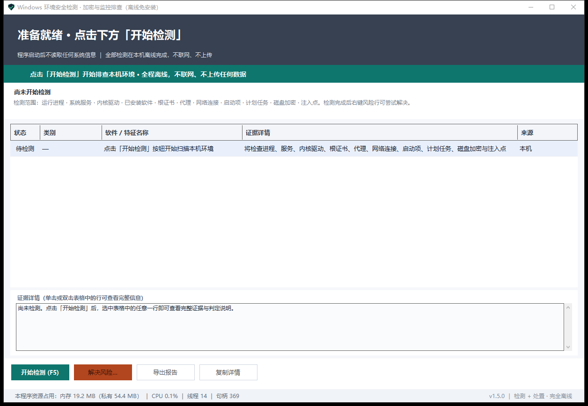
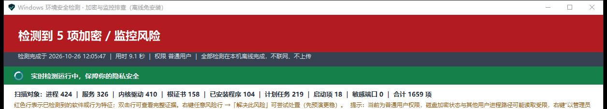
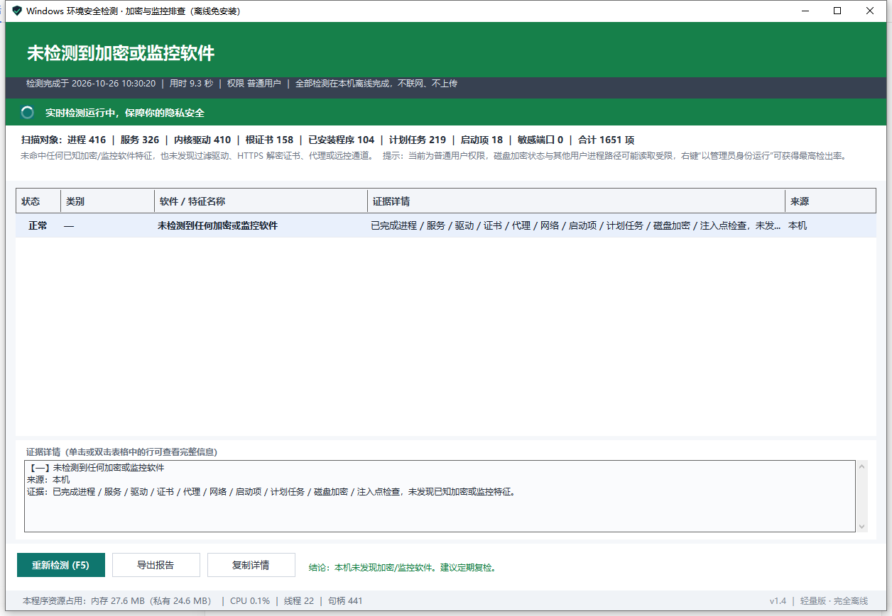

<div align="center">

# Windows Environment Security Check

**See exactly what is hiding on your machine — in one pass: transparent encryption, DLP agents, employee monitoring, remote control, keyloggers, traffic interception and HTTPS man-in-the-middle certificates. Beyond detection, it can remove leftovers you do not want, with full rollback.**

Single file · No installation · Fully offline · Zero upload · Free forever · Non-commercial

[](https://github.com/hage2000/windows-env-security-check/releases/latest)
[](#requirements)
[](#privacy--security-statement)
[](#licence-and-usage-boundaries)
[](LICENSE)

[简体中文](README.md) · [Download](#download--verify) · [Usage boundaries](#licence-and-usage-boundaries) · [Privacy](#privacy--security-statement) · [What it detects](#what-it-detects) · [Contributing](#contributing--branch-model)

</div>

---

> ## ⚠️ Usage boundaries (read first)
>
> - This is a **personal privacy and security self-check tool** for a computer **you own outright and that carries no organisation-managed agent**. Personal devices only.
> - **Downloading, installing or running this program on equipment issued by an employer, government body, school, contractor or any organisation — or on any device connected to an organisation's network or subject to its management — is prohibited.**
> - **Using this program to circumvent, disable or defeat security controls, auditing, monitoring or data-protection measures lawfully deployed by any organisation is prohibited.** Any such misuse (including misuse of a modified build) and all consequences arising from it are **unrelated to the author and are borne entirely by the user**.
> - This program contains **no** capability to generate, build, drop or distribute trojans, viruses, worms, ransomware, keyloggers or data-stealing software, **no** capability to intrude on or control someone else's device, and no function that violates the laws of the People's Republic of China.
> - This program is **entirely original work**, designed and implemented by the author. It is not a repost, not a modification or repackaging of anyone else's software.
> - This program is **free forever**, published in an open, sharing spirit for individual privacy self-checks, and will **never have any commercial purpose**. Selling, reselling, bundling, paid redistribution, or any direct or indirect monetisation of this program is prohibited.

---

## Why this tool matters

Most invasive software never appears under *Settings → Apps*.

- **Transparent encryption / DLP clients** encrypt your files in place: they open normally inside a licensed environment and turn into garbage the moment you take them home. The agent also injects itself into every process you run, reading clipboard, prints and screenshots.
- **Screen and activity monitoring** captures screenshots every few seconds, logs window titles and counts idle time. No tray icon, no recognisable process name.
- **Remote control** may be holding an established session right now, with someone watching your screen and moving your mouse.
- **Keyloggers** silently record every keystroke — passwords, chats, banking — to disk.
- **HTTPS MITM certificates + system proxy** install a root certificate into your *Trusted Root* store, so your bank, mailbox and web messengers are plaintext at the gateway.
- **Audit drivers / injected DLLs** (AppInit_DLLs, Winlogon tampering, IFEO hijacking) make the question "who is watching me?" unanswerable by eye.

What they share: **silent install, invisible runtime, no uninstall entry, no user notification** — while holding your most private data.

**This tool lays that invisible layer out in front of you, item by item, with evidence.** Product name, vendor, on-disk path, PID, service and kernel driver, third-party DLLs injected into this very process, root certificate issuer, system proxy address, real outbound state of remote-control processes — rendered as a red/green verdict that needs no security knowledge to read.

> Detection is strictly read-only. It does not block, clean or change a single system setting — unless you tick the actions yourself and press *Start* in the remedy dialog.

---

## Download & verify

| Item | Value |
| --- | --- |
| Latest build | [**Releases → download `WindowsEnvSecurityCheck.exe`**](https://github.com/hage2000/windows-env-security-check/releases/latest) |
| Download name | `WindowsEnvSecurityCheck.exe` |
| Size | 49,372,622 bytes (≈ 47.1 MB) |
| Version | 1.5.0 |
| SHA-256 | `C01BEFFAC9F3C29CE0F2C37EBF2E40B17425C48171873AF8E915781ACDD7FE00` |

> **About the file name**: the original binary is named `Windows环境安全检测.exe`, but GitHub Releases strips non-ASCII characters from asset names, so the download is called `WindowsEnvSecurityCheck.exe`. It is **the same binary** with an identical SHA-256; renaming it back changes nothing. The UI, window title and all output remain in Chinese.

Verify with one PowerShell command:

```powershell
Get-FileHash -LiteralPath ".\WindowsEnvSecurityCheck.exe" -Algorithm SHA256 | Format-List
```

A matching hash means the binary was not altered or substituted in transit.

> **Why is the binary a Release asset instead of a tracked file?** To keep the repository light — a clone pulls only a few hundred KB of docs and screenshots. The ~47 MB single-file binary ships through GitHub Releases, each with its SHA-256 published for independent verification.

---

## Privacy & security statement

Every line below can be verified by you personally:

| Commitment | What it means in practice |
| --- | --- |
| **No network** | No HTTP/HTTPS/socket client code, no domain resolution, no requests of any kind. Telemetry, crash reporting, update checks, activation — **none of it exists**. |
| **No upload** | No personal data, file contents, process lists or scan results are collected, cached or transmitted. Findings live in memory plus the local report file you export yourself. |
| **Read-only detection** | The scan writes nothing: no registry, no system directories, no services, no autoruns, no scheduled tasks, no certificates, no proxy changes. |
| **Controlled remediation** | Only after you tick actions in the dialog and press *Start* does it modify local configuration — and every change is snapshotted first, one-click rollback included. |
| **No dependencies** | The runtime is bundled into the exe. No runtime install, no downloads on the target machine. |
| **Restrained privileges** | Every detection path works as a standard user. Elevation only unlocks full process paths, BitLocker state and certain remediation actions. |

### Prove the "no network" claim yourself

1. **Resource Monitor**: `Win+R` → `resmon` → *Network* tab → check for any TCP/UDP endpoint or Send/Receive bytes. It stays at zero.
2. **Outbound firewall block**: `wf.msc` → *Outbound Rules* → block all outbound traffic for this executable → scan again. **Results are identical.**
3. **Physically unplug**: disable Wi-Fi / pull the cable and run it. No feature degrades.
4. **Process Monitor** (Sysinternals): filter `Process Name is WindowsEnvSecurityCheck.exe` + `Operation is TCP/UDP Send`. Zero hits.

If any check fails, call it out publicly in [Issues](https://github.com/hage2000/windows-env-security-check/issues) — this is a promise we intend to keep falsifiable.

---

## What it detects

A full read-only scan takes roughly 5–15 seconds (~1,600–1,700 evidence points). Any hit turns the top banner red and lists every finding with **product name, vendor, path, PID, service/driver details**; a clean machine gets a green *Not detected* result.

| Category | Coverage |
| --- | --- |
| **Transparent encryption / DLP clients** | EsafeNet, TianRui Lvdun, Xunsoft DSE, Huatu, Zhongfu, IP-guard, SkyGuard, Mingchao Wanda, Topsec, Wangyu, RenZXing and more |
| **Filesystem encryption filter drivers** | Any driver with `Group=FSFilter Encryption` counts as transparent encryption, even from an unlisted vendor |
| **Disk / full-disk encryption** | BitLocker, VeraCrypt, TrueCrypt, BestCrypt, DiskCryptor, enterprise FDE |
| **Remote control / screen sharing** | AweSun, TeamViewer, AnyDesk, ToDesk, RustDesk, VNC, Radmin, Splashtop, Chrome Remote Desktop, Quick Assist — plus whether the process holds an `ESTABLISHED` session |
| **Keyloggers / spyware** | Ardamax, Actual Keylogger, SuperEye, WangYan, YuZhiDun, NetRobust, WorkWin, StaffCop, Spyrix and more |
| **Screen / employee monitoring** | Teramind, ActivTrak, Hubstaff, Time Doctor, Kickidler, Veriato, Controlio, Insightful and more |
| **Endpoint management / EDR / AV** | Huorong, QiAnXin TianQing, Sangfor, Asiainfo, NSFOCUS, DBAPPSecurity, VenusTech, LeagSoft, Beixinyuan, CrowdStrike, SentinelOne, Carbon Black, Symantec, McAfee/Trellix, ESET, Kaspersky, Sophos, FortiClient, Cortex XDR, SCCM, Tanium, Splunk/Elastic/Wazuh/osquery and more |
| **Packet capture / traffic inspection** | Wireshark, Npcap, WinPcap, WinDivert, USBPcap, Fiddler, Charles, mitmproxy, Burp Suite, Proxyman, Reqable and more |
| **HTTPS MITM certificates** | Trusted-root entries for Fiddler / Charles / Burp / Zscaler / Netskope / Fortinet / AV SSL-scanning certificates |
| **Traffic proxying** | WinINET proxy, PAC auto-proxy, WinHTTP proxy |
| **System audit hooks** | Sysmon, Windows Event Forwarding (WEF), RDP shadow sessions without consent, Windows Recall enabled |
| **Suspicious injection / hooks** | AppInit_DLLs, AppCertDlls, Winlogon tampering, IFEO hijacking, and **third-party DLLs injected into this process itself** |
| **Remote sessions** | RDP enabled / logged on, WinRM, listening VNC / Radmin / TeamViewer ports |

> Microsoft Defender, which ships with Windows, is deliberately excluded so that default OS protection is never reported as "monitoring".

---

## New in v1.5.0: remediation with rollback

Right-click any finding → *Resolve this risk…*. The program derives a set of **tickable, minimal actions** for that risk type, supports a dry run first, reports a per-action result or a precise failure reason, snapshots every change and allows one-click rollback.

- **Dry run**: lists what would happen, writes the log, touches nothing.
- **Rollback**: restores in reverse order (decoy process/service → service config and start type → autorun/scheduled task → certificates → proxy and registry values).
- **Audit trail**: `%LOCALAPPDATA%\EnvSentry\remedy\` holds `audit.log`, per-run `journal-*.json`, `backup\` (`.cer`, task XML, registry text) and `latest.json`.
- **Failure reasons**: per action — access denied (5), service not responding (1053), driver cannot be stopped online (1052), not in safe mode (1084), administrator required. No silent "it failed".

Remediation covers monitoring tools, transparent-encryption/DLP agents, and policy/configuration artifacts (root certificates, proxies, audit hooks, injection points, RDP, BitLocker). 122 vendor playbooks ship built in; unlisted products are handled by parsing real PIDs, service names, drivers, autoruns, tasks and certificate thumbprints from the evidence.

**Boundaries**: local remediation cannot forge a server-side heartbeat — the management console may still see "device online, no data". Targets with PPL / tamper protection / kernel self-defence return access-denied and the program stops with a clear reason. Encryption filter drivers cannot be unloaded online, and encrypted files do not become plaintext. See section 10 of [使用说明.txt](使用说明.txt).

> These capabilities exist solely to clean **your own personal device**. Using them on organisation-issued equipment or to evade organisational controls is an expressly prohibited use — see [Usage boundaries](#licence-and-usage-boundaries).

---

## Screenshots

| Ready to scan | Verdict: red banner when anything is found |
| --- | --- |
|  |  |

| Clean machine: green "not detected" |
| --- |
|  |

Single-click any row for the evidence panel; double-click to open it in a separate window.

> Every screenshot in this repository is redacted: no user names, host names, install paths, IP addresses or organisation details.

---

## Measured footprint

| State | Working set | Private bytes | CPU |
| --- | --- | --- | --- |
| Just launched, idle | 17–25 MB | 52–54 MB | ~0.1% |
| After a scan (live monitoring on) | 30–35 MB | ~68 MB | ~0.0% |
| Live-monitor spinner animation | no visible growth | no visible growth | **~0.06%** (4 s average) |

- One 47.1 MB file, self-contained (win-x64 / Release) — **no runtime required on the target machine**.
- A full scan covers ~1,600–1,700 evidence points in about 9–15 seconds.
- Minimising to tray pauses resource sampling and animation; background cost approaches zero.
- A process-name-only sweep every 10 seconds; a new monitoring process triggers a red top-bar alert, followed by an automatic rescan 2.5 s later.

## Requirements

- **Windows 10 (1607+) / Windows 11, 64-bit**
- No installer, no runtime, no network
- Double-click to run; running as Administrator is recommended for complete process paths and BitLocker state (the UI shows a yellow "limited detection" notice otherwise)
- On first launch SmartScreen may warn because the binary is unsigned: *More info* → *Run anyway*

## Usage

1. Double-click the downloaded `WindowsEnvSecurityCheck.exe` → the *Ready* window appears
2. Click the green **Start scan (F5)** button; it finishes in 5–15 seconds
3. The top banner is the verdict; each table row is one finding — single-click for evidence, double-click for the full text
4. Bottom bar: `Re-scan (F5)` · `Resolve risk…` · `Export report` · `Copy details (Ctrl+C)`
5. `X` **minimises to the tray** instead of exiting; to quit: right-click the tray icon → *Exit*

> The full manual (Chinese) lives in [使用说明.txt](使用说明.txt).

---

## Limitations

- Signature library plus generic behavioural heuristics. A bespoke, unlisted tool may be missed by name — but its encryption filter driver, HTTPS decryption certificate, remote-control channel or injected DLL will still trip the generic rules.
- Under standard user rights, some process paths and disk-encryption states cannot be read (the UI says so in yellow).
- Local remediation cannot forge a remote heartbeat and cannot defeat PPL / tamper protection / kernel self-defence.
- Remediation does not create a restore point; back up important data first.

---

## Licence and usage boundaries

**1. Scope of use.** For individual users on their own personal computers only. Use on equipment issued by an organisation, on devices connected to an organisation's network, or on any device subject to organisational management is prohibited. Using this program to circumvent, disable or defeat security controls, auditing, monitoring or data-protection measures lawfully deployed by any organisation is prohibited.

**2. No malicious capability.** This program provides no means to generate, build, drop or distribute trojans, viruses, worms, ransomware, keyloggers or data-stealing software, no means to intrude on or control another person's device, and no function that violates the laws of the People's Republic of China.

**3. Free forever, non-commercial.** This program is free forever, published in an open, sharing spirit for individual use, and will never have a commercial purpose. Selling, reselling, renting, bundling, paid redistribution, or making it part of a paid service, course or community is prohibited; any direct or indirect monetisation is prohibited.

**4. Original work.** Designed and implemented entirely by the author. Not a repost, not a modification, repackaging or cracking of anyone else's software.

**5. Disclaimer.** Provided "as is", without warranty of any kind. Any direct or indirect loss, data loss, system damage, compliance or legal consequence arising from use or misuse is borne by the user; misuse (including misuse of a modified build) is unrelated to the author. See [LICENSE](LICENSE) and [DISCLAIMER.md](DISCLAIMER.md).

**6. Contributions.** The repository is maintained openly: fork and open Pull Requests (detection rules, wording, bug fixes). Submitting a PR means you agree your contribution is merged under the same terms.

---

## Contributing & branch model

**`main` is protected — nobody can push to it directly.** Every change, including the maintainer's own, goes through a Pull Request:

```
fork / feature branch  →  Pull Request  →  CODEOWNERS review  →  Squash merge  →  main
```

| Rule | Status |
| --- | --- |
| Direct / force pushes and deletion on `main` | 🚫 blocked |
| All changes must go through a Pull Request | ✅ required |
| Review from [CODEOWNERS](.github/CODEOWNERS) (@hage2000) | ✅ required |
| At least 1 approval; new commits dismiss previous approvals | ✅ required |
| All review conversations resolved before merge | ✅ required |
| External users may fork and open PRs | ✅ allowed |

**Welcome**: new signatures, additional detection paths, UI/accessibility improvements, wording fixes, false-positive and false-negative reports.
**Merge authority**: only the maintainer @hage2000 can approve and merge into `main`.

Read [CONTRIBUTING.md](CONTRIBUTING.md) before opening a PR. For security issues follow [SECURITY.md](SECURITY.md).

---

<div align="center">

**You have the right to know what is installed on your machine.**

[⬆ Back to top](#windows-environment-security-check) · [Latest release](https://github.com/hage2000/windows-env-security-check/releases/latest) · [Report an issue](https://github.com/hage2000/windows-env-security-check/issues)

</div>
